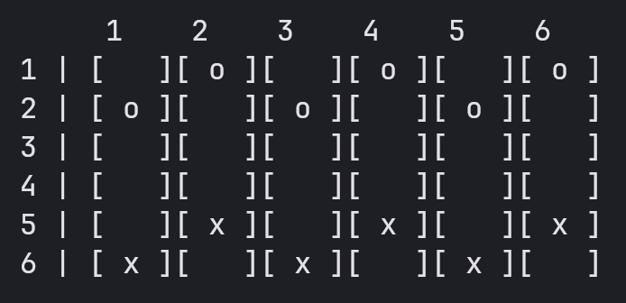
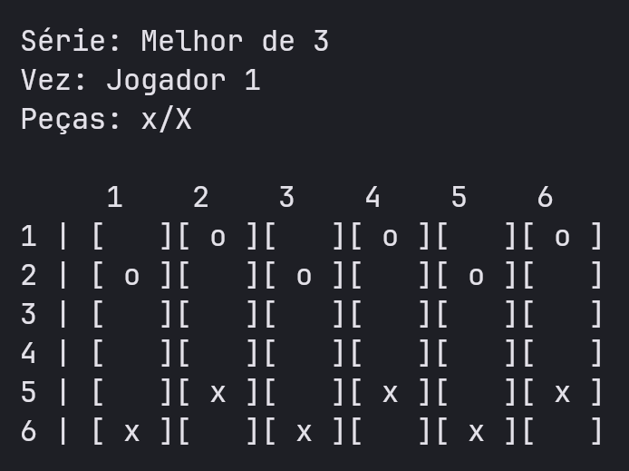
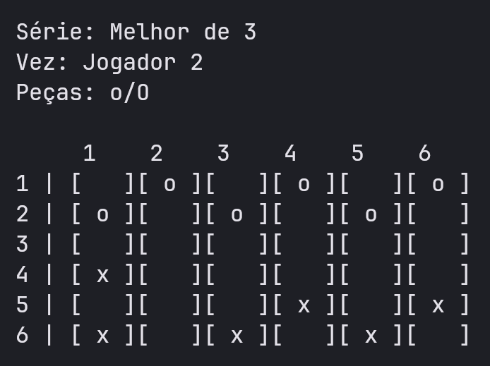

<div align="center">

# 🎮 Jogo de Damas Brasileira 6x6 no Terminal

**Damas brasileira para dois jogadores, feito em Python e direto no terminal** 🐍


🎓 Trabalho da 2ª Avaliação — Bacharelado em Ciência da Computação (UNINASSAU)

📘 Disciplina: Coding · 👨‍🏫 Professor: M.Sc. Tiago Martins Ribeiro

</div>

---

## 📖 Sobre o nosso projeto

O objetivo do projeto é contruir um jogo de tabuliero em linguagem Python utilizando de forma integrada apenas os conteúdos estudados na disciplina de Coding, como tipos de dados, operadores (aritiméticos, lógicos e relacionais), estruturas de decisão, matrizes e entre outros conteúdos, no qual o tabuleiro é representado por uma matriz e percorrido com for aninhado. Além disso, o processo de desenvolviento precisa ser documentado utilizando boas práticas de versionamento de código (Git e GitHub), relatório técnico e vídeo explicativo.

### 👾 Jogo

O jogo é baseado na Damas Brasileira com tabuleiro e regras reduzidos. A dinâmica de jogo é realziada em um tabuleiro 6x6, com captura obrigatória, captura em sequência, promoção a dama, placar acumulado e séries de partida única, melhor de 3 ou melhor de 5.

<div align="center">

</div>

---

## 🚀 Como executar

Você só precisa do **Python 3.6 ou superior** e do arquivo `main.py`.

| Sistema | O que usar | Comando para jogar |
|---|---|---|
| 🪟 Windows | Python (python.org) + PowerShell ou Terminal | `python main.py` ou `py main.py` |
| 🍎 macOS | Terminal | `python3 main.py` |
| 🐧 Linux | Terminal | `python3 main.py` |
| 🤖 Android | Termux | `python main.py` |
| 📱 iPhone / iPad | a-Shell | `python3 main.py` |

> [!TIP]
> Existem dois jeitos de baixar o jogo: com `git clone https://github.com/phelpstwo/Dama.git` ou pelo botão verde **Code ▸ Download ZIP** no topo desta mesma página do GitHub (depois é só extrair a pasta).

<details>
<summary><b>🪟 Windows</b></summary>

<br>

1. Instale o Python pelo [python.org/downloads](https://www.python.org/downloads/). Na primeira tela do instalador, marque a caixa **"Add python.exe to PATH"** e clique em **Install Now**. (Também é possível instalar através da Microsoft Store, procurando por "Python".)
2. Use **Code ▸ Download ZIP** e extraia a pasta, ou, se tiver o Git:

   ```powershell
   git clone https://github.com/phelpstwo/Dama.git
   ```

3. **Abra o terminal dentro da pasta do jogo:** no Explorador de Arquivos, abra a pasta, clique na barra de endereço, digite `cmd` e aperte Enter.
4. **Execute:**

   ```powershell
   python main.py
   ```

   Se o Windows disser que `python` não é reconhecido, tente `py main.py`.

> [!NOTE]
> Se os acentos aparecerem trocados, use o **Windows Terminal** ou o **PowerShell** em vez do Prompt de Comando antigo.

</details>

<details>
<summary><b>🍎 macOS</b></summary>

<br>

1. **Abra o Terminal:** `⌘ + Espaço`, digite "Terminal" e aperte Enter.
2. **Veja se já possui o Python 3:**

   ```bash
   python3 --version
   ```

   Se aparecer a versão (3.6 ou maior), pule para o passo 3. Se o Mac pedir para instalar as **ferramentas de linha de comando**, aceite e espere terminar. Se ainda assim não houver Python 3, instale pelo [python.org/downloads](https://www.python.org/downloads/) ou, se você usa o Homebrew, com `brew install python`.
3. **Baixe o jogo** (com o Git, ou por **Code ▸ Download ZIP**):

   ```bash
   git clone https://github.com/phelpstwo/Dama.git
   cd Dama
   ```

4. **Execute:**

   ```bash
   python3 main.py
   ```

</details>

<details>
<summary><b>🐧 Linux</b></summary>

<br>

1. **Instale o Python 3 e o Git** (a maioria das distribuições já traz o Python):

   ```bash
   # Debian / Ubuntu / Mint
   sudo apt install python3 git

   # Fedora
   sudo dnf install python3 git

   # Arch / Manjaro
   sudo pacman -S python git
   ```

2. **Baixe e entre na pasta do jogo:**

   ```bash
   git clone https://github.com/phelpstwo/Dama.git
   cd Dama
   ```

3. **Execute:**

   ```bash
   python3 main.py
   ```

</details>

<details>
<summary><b>🤖 Android (Termux)</b></summary>

<br>

> [!WARNING]
> Instale o Termux pelo **F-Droid** ou pelas **Releases do GitHub** do projeto ([github.com/termux/termux-app](https://github.com/termux/termux-app)). A versão da **Google Play Store está desatualizada** e causa erros na instalação de pacotes.

1. **Instale o Termux** por uma das fontes acima e abra o app.
2. **Atualize os pacotes** e **instale Python e Git**.

   ```bash
   pkg update && pkg upgrade
   pkg install python git
   ```
> [!TIP]
> Se perguntar algo, responda `Y` ou `y`.

3. **Baixe o jogo e entre na pasta:**

   ```bash
   git clone https://github.com/phelpstwo/Dama.git
   cd Dama
   ```

4. **Execute:**

   ```bash
   python main.py
   ```

**Já tem o `main.py` na pasta Downloads do celular?** Dê acesso ao armazenamento e rode de lá:

```bash
termux-setup-storage
cd ~/storage/downloads
python main.py
```

> [!TIP]
> Se o texto quebrar de linha no meio das telas, gire o celular para o modo **paisagem**.

</details>

<details>
<summary><b>📱 iPhone / iPad (a-Shell)</b></summary>

<br>

Recomendo o **[a-Shell](https://apps.apple.com/app/a-shell/id1473805438)**, pois é gratuito, roda Python localmente (sem internet) e já traz `curl` e `lg2` (o Git do app). Aplicativos como Pythonista e Pyto também funcionam, mas o a-Shell não custa nada.

1. **Instale o a-Shell** pela App Store e abra o app.
2. **Baixe o jogo.** Escolha **apenas uma** das opções:

   **Opção A: só o arquivo (mais simples)**

   ```bash
   curl -O https://raw.githubusercontent.com/phepstwo/Dama/main/main.py
   ```

   **Opção B: o repositório inteiro, com o Git do app**

   ```bash
   lg2 clone https://github.com/phelpstwo/Dama.git
   cd Dama
   ```

   **Opção C: o arquivo já está no app Arquivos** (iCloud Drive ou "No meu iPhone"). Digite `pickFolder`, escolha a pasta onde ele está e confirme. O terminal entra nela.

3. **Execute:**

   ```bash
   python3 main.py
   ```

> [!NOTE]
> No a-Shell, o iOS só deixa o app escrever na própria pasta (`~/Documents`). Para acessar arquivos de outros apps, use o comando `pickFolder`.

</details>

### 🛠️ Problemas comuns

| Problema | O que fazer |
|---|---|
| `python` ou `python3` "não é reconhecido" / "command not found" | Tente o outro nome (`python`, `python3` ou `py`). No Windows, reinstale o Python marcando **Add python.exe to PATH**. |
| `SyntaxError` perto de um `f"..."` | A versão do Python é muito antiga. Rode `python3 --version`: a versão precisa ser **3.6 ou superior**. |
| `No such file or directory: 'main.py'` | Você não está na pasta do jogo. Entre nela com `cd Dama`. |
| Acentos trocados no Windows | Use o Windows Terminal ou o PowerShell. |
| Texto quebrando no celular | Use o modo paisagem. |

---

## 🕹️ Como jogar

1. No menu principal, escolha a opção **Jogar**.
2. Digite o nome dos dois jogadores (só é pedido uma vez por sessão).
3. Escolha o modo: **partida única**, **melhor de 3** ou **melhor de 5**.
4. A cada turno, o jogo mostra o tabuleiro e pede **quatro números de 1 a 6**:
   - 📍 linha de origem e coluna de origem (a peça que você quer mover);
   - 🎯 linha de destino e coluna de destino (para onde ela vai).

Se você digitar algo inválido (letra, símbolo, campo vazio, número fora de 1 a 6) ou fizer um movimento que não é permitido, o jogo mostra uma mensagem e pede de novo, sem fechar.

### ⚫ Peças

| Jogador | Peça comum | Dama | Direção |
|---|---|---|---|
| **Jogador 1** (começa) | `x` | `X` | sobe ⬆️ |
| **Jogador 2** | `o` | `O` | desce ⬇️ |

### ✏️ Exemplo de jogada

Para mover o `x` da **linha 5, coluna 2** para a **linha 4, coluna 1**:

```
Linha de origem (1 a 6): 5
Coluna de origem (1 a 6): 2
Linha de destino (1 a 6): 4
Coluna de destino (1 a 6): 1
```

| Antes | Depois |
|:---:|:---:|
|  |  |

---

## 📜 Regras do jogo

- Tabuleiro 6x6. Cada jogador começa com 6 peças, nas casas escuras.
- A peça comum anda 1 casa na diagonal, para frente.
- Captura: salto de 2 casas sobre uma peça adversária, para frente ou para trás.
- A captura é obrigatória. Havendo mais de uma, o jogador escolhe qual fazer.
- Captura em sequência: se a mesma peça puder capturar de novo, ela deve continuar a jogada.
- Promoção: ao terminar a jogada na última linha do adversário, a peça vira dama (`X` ou `O`). Isso só acontece ao fim da jogada: se a peça chegar lá no meio de uma sequência de capturas, ela continua como peça comum até a sequência terminar.
- A dama anda 1 casa e captura (salto de 2 casas) nas 4 diagonais.
- Vitória: vence quem eliminar as peças do adversário ou deixá-lo sem movimentos.
- Empate: 20 jogadas seguidas sem nenhuma captura (valor da variável `limites_sem_captura`).

---

## 🏅 Modos de jogo

| Modo | Vitórias necessárias | Observação |
|---|---|---|
| **Partida única** | 1 | Termina ao fim de uma partida, inclusive se der empate. |
| **Melhor de 3** | 2 | Termina quando alguém garante a maioria. |
| **Melhor de 5** | 3 | Termina quando alguém garante a maioria. |

- Nas séries, o **empate não conta** para nenhum jogador e a série continua.
- Ao fim de cada partida, o jogo mostra o tabuleiro final, o resultado, o placar da série e o placar acumulado.
- Depois de uma série, o jogador volta ao menu de séries e pode jogar de novo, **sem reiniciar o programa**. 🔄

---

## 📊 Placar

A opção **Placar** do menu principal mostra, de toda a sessão:

- 🥇 vitórias de cada jogador e empates;
- 🔢 total de partidas jogadas;
- 📈 porcentagem de aproveitamento de cada jogador e de empates;
- 🏆 séries ganhas por cada jogador.

---

## 🎯 Desafio de lógica implementado

**Campeonato "melhor de N"** (nível básico): no menu de séries o jogador escolhe partida única, melhor de 3 ou melhor de 5. O programa conta as vitórias e encerra a série assim que alguém garante a maioria, anunciando o campeão.

No código, ele aparece no bloco **MENU DE SÉRIES** (variáveis `vit_necessarias`, `vit_serie1`, `vit_serie2` e `serie_encerrada`) e no anúncio do campeão ao fim da série.

---

## 📚 Conteúdo utilizado

O programa foi feito com o conteúdo estudado em aula:

- Tipos de dados e variáveis (inteiros, textos, booleanos e reais);
- Operadores aritméticos, relacionais e lógicos (`and`, `or`, `not`);
- Estruturas de decisão (`if`, `elif`, `else`);
- Estruturas de repetição (`while`, `for` e `range()`);
- Matriz (lista de listas) e `for` aninhado, para exibir, reiniciar, consultar e atualizar o tabuleiro e verificar capturas e movimentos;

Para formatar as mensagens também foram usadas f-strings, por exemplo `print(f"Vez: {nome_vez}")`.

Não foram usadas funções próprias, bibliotecas, dicionários, tuplas, conjuntos, listas de uma dimensão, métodos de lista ou texto, `try/except` nem classes.

---

## 👥 Equipe e divisão de tarefas

| Integrante | GitHub | Responsabilidades |
|---|---|---|
| **Philipe Gabriel** | [@phelpstwo](https://github.com/phelpstwo) | Líder técnico, organização estrutural do projeto, dinâmica séries e turnos, bom como movimentação, promoção e captura de peças. |
| **Yan Elvis** | [@yanelvisdiasdias-del](https://github.com/yanelvisdiasdias-del) | Menu de inical, menu de regras e menu das séries. |
| **João Davi** | [@joaodavi45186-maker](https://github.com/joaodavi45186-maker) | Menu do placar, validação das entradas dentro dos menus e implementação da opção de sair/voltar nos menus. |

---

## 🔗 Links

- 📄 **Relatório técnico:** (a ser anexado)
- 🎬 **Vídeo explicativo:** (a ser axenado)